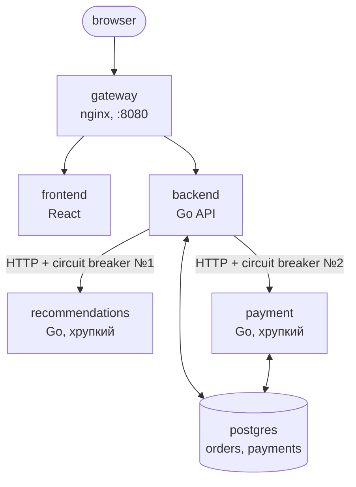

# SRE Observability Lab

Локальный стенд для работы с метриками, логами и трейcами в сервисном
приложении.

## Архитектура



Витрина умеет: смотреть каталог, открывать карточку товара (с
рекомендациями через circuit breaker), **добавлять товары в корзину** и
**оформлять заказ** ("Купить") - оформление идёт через `backend`, который
считает сумму по ценам из БД и обращается к `payment` (тоже через
отдельный circuit breaker) для списания денег.

| #  | Сервис | Роль | Порт на хосте |
|----|---|---|---|
| 1  | `frontend` | React-витрина товаров, корзина, оформление заказа | (только через gateway) |
| 2  | `backend` | Go API: товары, карточка + рекомендации, оформление заказа (`/api/orders`) | `8081` |
| 3  | `postgres` | Хранилище товаров, заказов и платежей | `5432` |
| 4  | `recommendations` | Go, "хрупкая" зависимость для circuit breaker №1 | `8082` |
| 5  | `payment` | Go, "хрупкая" зависимость для circuit breaker №2 (оплата заказа) | `8083` |
| 6  | `grafana` | Дашборды и Explore для метрик/логов/трейсов | `3000` |
| 7  | `victoriametrics` | Хранилище метрик (Prometheus-совместимое) | `8428` |
| 8  | `tempo` | Хранилище трейсов (OTLP) | `3200`, `3117/3118` (гостевые OTLP) |
| 9  | `victorialogs` | Хранилище логов | `9428` |
| 10 | `gateway` | nginx, единая точка входа + X-Request-ID | `8080` |
| 11 | `vmalert` | Выполняет алерты по метрикам, шлёт в Alertmanager | `8880` |
| 12 | `alertmanager` | Дедупликация и маршрутизация уведомлений | `9093` |
| 13 | `otel-collector` | Приём OTLP от приложений → трейсы в Tempo + service graph метрики в VictoriaMetrics | `4317/4318` |
| 14 | `alertreceiver` | Печатает уведомления Alertmanager в stdout (для стенда) | - |
| 15 | `mailpit` | Тестовый SMTP-сервер: ловит email-уведомления Alertmanager, UI просмотра писем | `8025` |
| 16 | `vector` | Собирает stdout контейнеров → VictoriaLogs | - |

## Запуск

Нужен Docker и Docker Compose (v2). Сборка требует интернет - Go-модули,
npm-пакеты и образы качаются во время `build`.

```bash
docker compose up --build -d
docker compose ps        # все сервисы должны быть healthy/running
```

Открыть:

- **Витрина**: http://localhost:8080
- **Grafana**: http://localhost:3000 (admin/admin, но анонимный доступ тоже включён)
- **VictoriaMetrics UI** (vmui, /targets): http://localhost:8428
- **vmalert UI** (статус правил и алертов): http://localhost:8880
- **Alertmanager UI** (активные алерты): http://localhost:9093
- **VictoriaLogs UI**: http://localhost:9428
- **Tempo** (обычно смотрят через Grafana, не напрямую): http://localhost:3200
- **Mailpit** (входящие email-уведомления Alertmanager): http://localhost:8025

Проверить, что стенд наполняется данными - открыть витрину и покликать
несколько товаров: это создаст трафик, который сразу увидят метрики, логи
и трейсы.

Некоторые настройки приложения доступны в админ-панели по адресу
http://localhost:8080/admin/. Панель предназначена только для локального
стенда.

> **Важно для новой схемы БД:** в `db/init.sql` добавлены таблицы
> `users`, `reviews`, `stock_movements` и колонка `stock` (а также seed-юзер
> `admin`). Поскольку `init.sql` исполняется только на пустой БД, при первом
> переносе на новую схему нужно **пересоздать volume**:
>
> ```bash
> docker compose down -v
> docker compose up --build -d
> ```

## Функционал стенда

У тестового стенда есть свои фичи со **своими метриками,
логами и трейсами**.

### Пользователи и сессии

- **Вход по имени без пароля.** Нажмите
  поле имени в шапке витрины, введите имя (например `admin` или `alice`) и
  «Войти». Backend выводит и сохраняет пользователя в таблицу `users`,
  заводит in-memory сессию и отдаёт токен; фронт хранит токен в
  `localStorage`.
- **Роли.** Готовый пользователь `admin` имеет роль `admin` и видит ссылку «⚙ Управление
  лабой». Любой другой пользователь получает роль `user` и этой ссылки не
  видит. Роль проверяется **на backend по in-memory сессии**, а не по одному
  заголовку: притвориться админом, просто прислав `X-User-Name: admin`, нельзя.
- **Авторизация админ-ручек:** без сессии → `401`; с сессией, но роль не
  `admin` → `403`. Прямые `/lab-admin/*` пути для не-админа отдают 401/403,
  ничего не «светя» наружу.
- **История покупок привязана к пользователю.** Каждый заказ хранит
  `user_id` покупателя. Страница «📋 История покупок» (`/history`) доступна
  только залогиненным (`401` анониму): **admin видит все заказы** и имя
  покупателя в каждом, **обычный пользователь - только свои**. Сам checkout
  (`POST /api/orders`) тоже требует входа (`401` без сессии), иначе некому
  приписать покупку.
- Метрики: `backend_user_logins_total`, `backend_active_sessions`,
  `backend_admin_denied_total`. События: `user_login`, `user_logout`,
  `admin_access_denied`. Операции: `session.create`, `session.delete`.

### Склад

- У товаров есть остаток `stock`; на витрине и в карточке видно
  «В наличии: N шт.» / «Нет в наличии». Кнопка «+ В корзину» для товара без
  остатка отключена.
- **Покупка списывает остаток.** В `checkout` перед оплатой выполняется
  `inventory.reserve`: если остатка не хватает - заказ **НЕ создаётся**
  (в отличие от payment-флоу, где заказ сохраняется всегда), ответ `409`.
- **Если оплата после резервирования не прошла** - остатки **возвращаются**
  на склад компенсирующим движением (`unreserve`). Оба движения пишутся в
  ledger `stock_movements` - это дополнительный источник наблюдаемости.
- **Restock** - только через админ-панель (раздел «📦 Склад (остатки)»);
  восполнение фиксируется движением `restock`.
- Метрики: `backend_stock_movement_total{reason=...}`,
  `backend_orders_blocked_by_stock_total`, `backend_low_stock_products`,
  `backend_inventory_restock_total`. События: `order_blocked_low_stock`,
  `inventory_restocked`. Операции: `inventory.reserve`, `inventory.restock`.

### Отзывы и рейтинги

- В карточке товара появился блок «⭐ Отзывы»: список, средний рейтинг и форма
  добавления. **Оставить отзыв можно только будучи залогиненным** (`401`
  анониму). Валидация: рейтинг 1..5 и непустой комментарий - иначе `400` и
  метрика отказов.
- Агрегированные `avg_rating`/`rating_count` приходят в ответах
  `/api/products` и `/api/products/{id}`.
- Метрики: `backend_reviews_posted_total`,
  `backend_reviews_rejected_total`, `backend_reviews_by_rating_total`.
  События: `review_created`, `review_failed`. Операции: `reviews.post`,
  `reviews.list`.

## Алертинг

Стенд включает полноценный путь алертов и показывает, как связаны метрики,
алерты и уведомления:

```
VictoriaMetrics  ──(скрейп)──▶  метрики
      ▲
      │ PromQL
   vmalert  ─(firing)─▶  Alertmanager  ─(webhook)─▶  alertreceiver ──▶  stdout → Vector → VictoriaLogs
```

- **vmalert** каждые `5s` (по умолчанию) выполняет правила из
  `vmalert/alerts.yml` против VictoriaMetrics. Если выражение вернуло непустой
  результат дольше `for`, алерт переходит в `firing` и уходит в Alertmanager.
  Статус правил и активных алертов смотрите на http://localhost:8880
  (там же `/api/v1/rules` отдают состояние в JSON для автоматизации).
- **Alertmanager** группирует и дедуплицирует алерты, а затем отправляет
  уведомления в приёмник. UI активных алертов - http://localhost:9093.
- **alertreceiver** - Go-сервис, webhook-приёмник уведомлений, который печатает
  каждое уведомление в stdout (JSON через slog). Его подбирает Vector и
  отправляет в VictoriaLogs, поэтому **уведомления об алертах видны в логах**
  так же, как обычные логи сервисов (через Grafana → Explore → VictoriaLogs,
  `source:"alertreceiver"`, по полю `msg="alert_notification"`). Есть
  `/healthz` и метрика `up{job="alertreceiver"}`.
- **Mailpit** - тестовый SMTP-сервер: Alertmanager отправляет email-уведомления
  на SMTP `mailpit:1025`, а письма смотрят в веб-UI на http://localhost:8025.
  Для локального стенда не нужен реальный почтовый ящик - достаточно открыть
  Mailpit и увидеть «пришедшее» письмо (заголовки, HTML-шаблон
  `alertmanager/template.tmpl`).

### Как проверить алерты

Выполните `docker compose up --build -d`, дождитесь готовности, затем сломайте
один из сервисов:

```bash
docker compose stop recommendations
```

Через ~30 секунд в vmalert (http://localhost:8880) появится `pending`, затем
`firing` для алерта `TargetDown` (severity `critical`); в Alertmanager
(http://localhost:9093) уведомление уйдёт в `alertreceiver` и будет видно в
логах. Верните сервис и убедитесь, что алерт `resolved`:

```bash
docker compose start recommendations
```

Другие примеры для демонстрации:

- **Circuit breaker / retry / bulkhead** - включите сбои у `recommendations`
  или `payment` через админ-панель (http://localhost:8080/admin/) и
  подождите алертов `CircuitBreakerOpen`, `RetriesExhausted`,
  `ManyBulkheadRejections`.
- **Доля ошибок / задержка** - задайте у `recommendations`/`payment`
  высокие `CHAOS_FAIL_RATE` или `CHAOS_LATENCY_MS` в `docker-compose.yml` и
  перезапустите. Загорится `HighErrorRatePayment`, `HighErrorRateRecommendations`
  и `HighLatencyBackend`.
- **Бизнес-метрики** - раскупите весь склад, чтобы сработал
  `LowStockProducts`/`HighOutOfStockRate`.

### Правила алертов

`vmalert/alerts.yml` содержит готовые примеры, сгруппированные по смыслу:

| Группа | Пример алерта | Что отслеживает |
|---|---|---|
| `availability` | `TargetDown`, `BackendScrapeFailing` | `up == 0`, недоступность целей |
| `red-errors` | `HighErrorRate` | Доля не-2xx ответов за минуту |
| `red-duration` | `HighLatencyBackend` | p95 задержки ответа |
| `resilience` | `CircuitBreakerOpen`, `RetriesExhausted`, `ManyBulkheadRejections` | Паттерны отказоустойчивости |
| `business` | `LowStockProducts`, `HighOutOfStockRate` | Бизнес-метрики стенда |
| `rate-limiting` | `RecommendationsRateLimited` | Отказы rate limiter'а |

Чтобы отправить алерты в реальный канал (Slack/Telegram/email), замените
`url` в `receivers` в `alertmanager/alertmanager.yml` на свой webhook (либо
укажите настоящий SMTP-смартхост и адрес в `email_configs` вместо Mailpit).

### Материалы по алертингу для лекции 8

- **`docs/lecture-08-alerting-practical.md`** - практические сценарии к лекции
  «Алертинг», привязанные к слайдам (pipeline, symptom/cause, `for`,
  grouping, inhibit, on-call).
- **`docs/lecture-08-teaching-track.md`** - хронометраж ведения лекции на 90 минут.
- **`scripts/demo-alerting.sh`** - интерактивное воспроизведение всех сценариев:

  ```bash
  ./scripts/demo-alerting.sh all        # все демо подряд
  ./scripts/demo-alerting.sh pipeline   # одно конкретное демо
  # меню доступных демо:
  ./scripts/demo-alerting.sh
  ```

## HW3 - метрики и алертинг checkout

### Архитектура и решение

В `backend/internal/obs/business_metrics.go` добавлены две метрики в namespace
`backend`:

```text
backend_checkout_attempts_total{result, outcome_type}
backend_checkout_duration_seconds_bucket{result, outcome_type, le}
```

`result` - ограниченное множество терминальных исходов: `paid`,
`card_declined`, `issuer_timeout`, `issuer_unavailable`, `db_unavailable`,
`payment_service_unavailable`, `out_of_stock`. `outcome_type` - стабильная
группа для алертов: `success`, `business_decline`, `technical_failure`,
`business_rejection`. Таким образом, можно читать точную причину в метрике и
одновременно строить устойчивые запросы по классу исхода. Ни один
`user_id`, `order_id`, `request_id` или `product_id` не является label.

В обработчике `POST /api/orders` есть единая функция `recordCheckout`, которая
защищена флагом и вызывается ровно один раз для каждого наблюдаемого
терминального исхода. Для `out_of_stock` запись делается после неуспешного
резервирования; для оплаты - после сохранения заказа. Гистограмма использует
бакеты 50ms, 100ms, 250ms, 500ms, 1s, 2.5s, 5s, 10s: они различают быстрые
бизнес-отказы, обычные покупки и задержки payment без чрезмерного числа
временных рядов.

`card_declined` - HTTP 200 на payment API и `BusinessDecline` в backend; он не
ретраится и `IsSuccessful` circuit breaker считает такой ответ успешным
вызовом зависимости. Поэтому это бизнес-событие, а не техническая авария.

### Команды и воспроизведение

```bash
docker compose up --build -d
docker compose ps

# Проверка новой метрики и отсутствия высококардинальных labels
curl -s http://localhost:8081/metrics | grep backend_checkout_
curl -s http://localhost:8081/metrics | grep backend_checkout_attempts_total

# Войти в стенд можно через UI http://localhost:8080 (например, alice).
# Затем оформить товар обычной кнопкой «Купить».
```

Для технического эксперимента войти как `admin`, открыть
`http://localhost:8080/admin/` и выставить payment chaos:

```json
{"stage":"bank","fail_rate":1,"latency_ms":0,"fail_kind":"issuer_timeout"}
```

Оформление заказа даст `result="issuer_timeout"` (либо
`payment_service_unavailable`, если payment уже недоступен или breaker открыт).
Для проверки бизнес-ветки выставить `fail_kind="card_declined"`: метрика получит
`result="card_declined", outcome_type="business_decline"`, HTTP checkout будет
402, а circuit breaker останется `CLOSED`.

После эксперимента обязательно вернуть:

```json
{"stage":"bank","fail_rate":0,"latency_ms":0,"fail_kind":"card_declined"}
```

Полезные запросы для доказательств:

```bash
# VictoriaMetrics / PromQL
curl -G 'http://localhost:8428/api/v1/query' \
  --data-urlencode 'query=sum by (result,outcome_type) (backend_checkout_attempts_total)'
curl -G 'http://localhost:8428/api/v1/query' \
  --data-urlencode 'query=backend_payment_circuit_breaker_state'

# Статус правил и firing/resolved
curl -s http://localhost:8880/api/v1/rules | jq '.data.groups[] | {name,rules}'

# Логи с конкретным request_id/trace_id
docker compose logs backend payment | grep '<request_id-or-trace_id>'
# В Grafana Explore: Tempo → trace_id; VictoriaLogs → _msg contains
# "checkout failed: payment service degraded" и тот же trace_id.
```

Ожидаемая цепочка улик для технического отказа: `checkout.process` →
`payment.request` → `bank.authorize`, в backend появляется structured log
`checkout failed: payment service degraded`, а счётчик увеличивается на
техническом `result`. Для `card_declined` видны `bank.authorize`, лог
`checkout failed: card declined`, отдельный бизнес-ряд метрики и отсутствие
перехода breaker в `OPEN`. Скриншоты UI Grafana/Alertmanager и JSON-ответы
этих команд следует приложить к pull request как evidence после запуска
стенда; репозиторий не подменяет их непроверяемыми картинками.

### Алерты

| Правило | Симптом и PromQL-смысл | Порог / `for` | Реакция |
|---|---|---|---|
| `CheckoutPaymentsFailing` | Доля `outcome_type="technical_failure"` среди всех checkout | `>20%`, минимум 3 тех. события за 2m; `15s` | `critical`, page через `oncall-webhook` |
| `CheckoutZeroPurchases` | Заказы были, но `paid` не было последние 2m | attempts `>0` и paid `==0`; `0s` | `critical`, page через `oncall-webhook` |
| `CheckoutCardDeclinesSpiking` | Массовый `card_declined`, а не единичный отказ | `>70%`, минимум 10 попыток за 5m; `2m` | `warning`, ticket через `ticket-webhook` |

В первых и третьих правилах `clamp_min` защищает деление при отсутствии
трафика. Первое правило физически не матчится на `card_declined`, потому что
выбирает только `outcome_type="technical_failure"`. Порог 20% означает, что
проблема уже влияет на заметную долю покупателей; 15 секунд достаточно для
критичного симптома и не задерживает page надолго. Второе правило имеет
почти нулевой `for`, потому что само окно уже равно требуемым двум минутам;
условие `attempts > 0` запрещает тревогу в тихое время. Для бизнес-отказов
нужны высокий объём, доля 70% и `for: 2m`: единичные отклонения штатны, а
устойчивый всплеск может означать сломанный контракт или тестовый трафик, но
не требует немедленного пробуждения дежурного.

В `alertmanager/alertmanager.yml` задано `group_by: [alertname, service]`:
один симптом одного сервиса приходит одной группой, а независимые сервисы не
смешиваются. `critical` маршрутизируется в `oncall-webhook`, `warning` - в
`ticket-webhook`; для локального стенда оба приёмника печатают уведомление в
`alertreceiver`. Inhibit-правило скрывает `CheckoutCardDeclinesSpiking`, пока
горит `CheckoutPaymentsFailing` для backend: технический page уже объясняет
проблему, а вторичный ticket не должен спамить тот же канал.

### Короткий runbook

1. Проверить Alertmanager/vmalert и подтвердить окно: метрика checkout,
   `up{job="backend"}`, число попыток и наличие `paid`.
2. Если горит технический alert, взять один `request_id` из backend-лога,
   открыть связанный trace и проверить `payment.request` → `bank.authorize` /
   `payments.persist`; затем проверить payment chaos и состояние breaker.
3. Безопасное действие для стенда - отключить chaos (`fail_rate=0`), не
   удалять данные и не сбрасывать breaker перезапуском без фиксации evidence.
   После восстановления дождаться `resolved` и проверить, что `paid` растёт.
4. `card_declined` не ретраить автоматически и не считать outage: при
   устойчивом всплеске открыть ticket владельцу checkout/payment; page нужен
   только при техническом ухудшении или нулевых покупках при наличии трафика.

## Структура репозитория

```
gateway/                    nginx: reverse proxy + X-Request-ID
frontend/                   React SPA (Vite): каталог, корзина, checkout
backend/                    Go API: products, orders/checkout, users, inventory, reviews, observability
recommendations/            Go, "хрупкая" зависимость с /admin/chaos
payment/                    Go, "хрупкая" зависимость с /admin/chaos (оплата заказа)
db/init.sql                 схема + seed-данные: products, orders, order_items, payments, users, reviews, stock_movements
victoriametrics/            scrape.yml - конфиг скрейпинга
vmalert/                    alerts.yml - правила алертов (PromQL)
alertmanager/               alertmanager.yml - группировка и маршрутизация уведомлений
alertreceiver/              Go webhook-приёмник, печатает уведомления в stdout
tempo/                      tempo.yaml - конфиг хранилища трейсов
otel-collector/             otel-collector.yaml - приём OTLP → Tempo + service graph → VictoriaMetrics
vector/                     vector.yaml - сборщик логов → VictoriaLogs
grafana/                    provisioning датасорсов + готовый дашборд
```

## Известные ограничения

- Образы VictoriaMetrics/VictoriaLogs/Tempo/Vector/Grafana/OTel Collector/Mailpit
  взяты с тегом
  `:latest` - для локального стенда это допустимо, но для воспроизводимой сборки стоит
  закрепить конкретные версии в `docker-compose.yml` под ваше окружение.
- Один экземпляр каждого сервиса.
- Нет ретеншена/бэкапов у VictoriaMetrics/VictoriaLogs/Tempo - это локальный стенд,
  данные хранятся в docker volumes без ограничения места на диске.
- Grafana открыта с анонимным admin-доступом - никогда не делайте так
  вне локального стенда.
- Если после `docker compose up --build` Grafana не видит датасорсы -
  подождите 10-15 секунд после старта (первичная установка плагинов
  VictoriaMetrics/VictoriaLogs для Grafana идёт при старте контейнера) и
  перезагрузите страницу.
- Корзина живёт только в state React (без персистентности) - это
  сознательное упрощение, чтобы не городить авторизацию/сессии в
  локальном стенде. Сохраняется в БД уже результат оформления - заказ.
- Сессии пользователей живут **in-memory** в backend: перезапуск backend
  «разлогинивает» всех (повторный вход - по имени). Сами пользователи,
  отзывы и остатки при этом сохраняются в БД.
- `payment` пишет в ту же Postgres, что и `backend` (таблица `payments`,
  отдельная от `orders`) - в реальной системе это была бы отдельная БД
  отдельного сервиса, здесь общий инстанс ради простоты стенда.

## Остановка и очистка

```bash
docker compose down          # остановить, оставить данные в volumes
docker compose down -v       # остановить и стереть все данные (метрики/логи/трейсы/БД)
```
